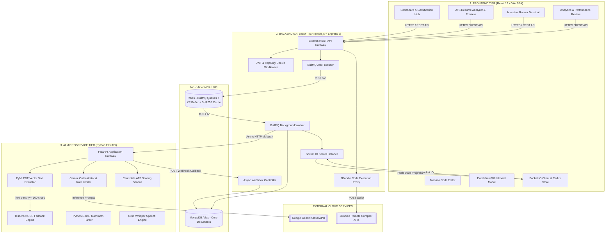
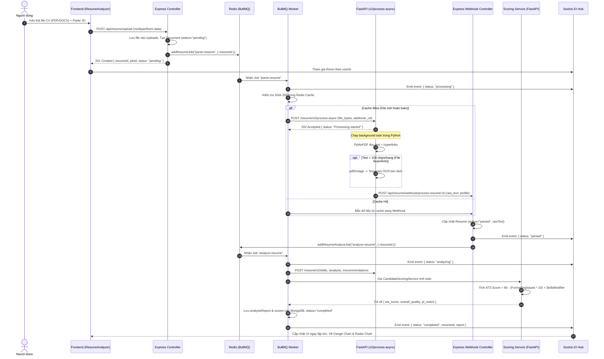
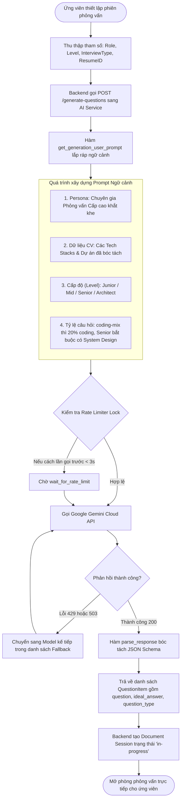
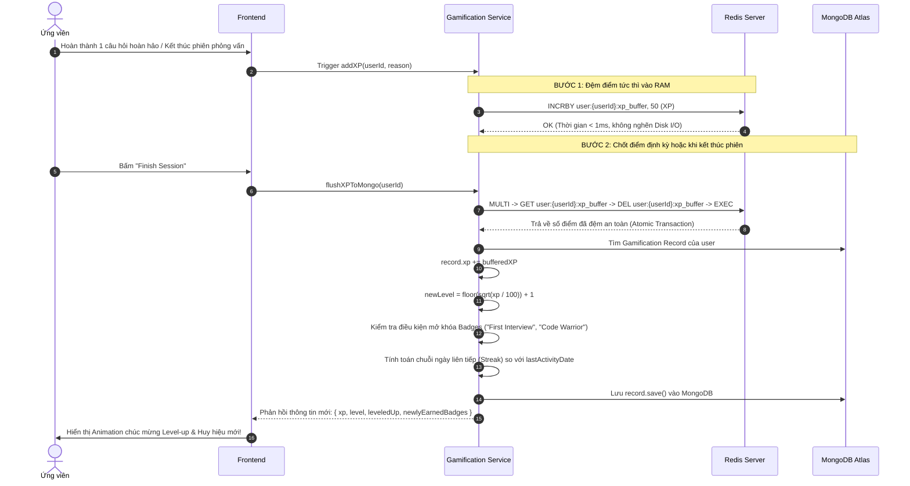

# HỆ THỐNG MÔ PHỎNG PHỎNG VẤN LẬP TRÌNH VỚI AI (PREPIFY)
> **Tài liệu Kỹ thuật Chuyên sâu, Luồng hoạt động End-to-End, Bản đồ Source Code và Cẩm nang 20 Câu hỏi Bảo vệ Đồ án**

---

## MỤC LỤC
1. [Giới thiệu tổng quan hệ thống (Deep-dive Overview)](#1-giới-thiệu-tổng-quan-hệ-thống-deep-dive-overview)
2. [Kiến trúc hệ thống chi tiết (Deep-dive Architecture)](#2-kiến-trúc-hệ-thống-chi-tiết-deep-dive-architecture)
3. [Luồng hoạt động chi tiết (End-to-End Deep-dive Flows)](#3-luồng-hoạt-động-chi-tiết-end-to-end-deep-dive-flows)
4. [Hướng dẫn đọc Source Code toàn diện (Full Codebase Walkthrough)](#4-hướng-dẫn-đọc-source-code-toàn-diện-full-codebase-walkthrough)
5. [Ma trận Mapping chi tiết Phiếu đề tài ⟷ Source Code](#5-ma-trận-mapping-chi-tiết-phiếu-đề-tài--source-code)
6. [Bộ 20 câu hỏi phản biện thường gặp khi bảo vệ đồ án (Kèm gợi ý trả lời chuyên sâu)](#6-bộ-20-câu-hỏi-phản-biện-thường-gặp-khi-bảo-vệ-đồ-án-kèm-gợi-ý-trả-lời-chuyên-sâu)

---

## 1. GIỚI THIỆU TỔNG QUAN HỆ THỐNG (DEEP-DIVE OVERVIEW)

### 1.1. Bối cảnh thực tế & Bài toán ngành
Trong quy trình tuyển dụng kỹ sư phần mềm hiện đại, vòng phỏng vấn kỹ thuật (Technical Interview) là giai đoạn có tỷ lệ đào thải cao nhất (thường từ 70% – 85%). Các ứng viên, đặc biệt là sinh viên mới tốt nghiệp hoặc lập trình viên Junior/Mid-level, thường đối mặt với các rào cản nghiêm trọng:
1. **Rào cản CV qua cổng ATS (Applicant Tracking System):** 
   - Hơn 90% các công ty công nghệ lớn (Fortune 500 và các Tech Unicorn) sử dụng các phần mềm ATS như Taleo, Greenhouse, Lever để lọc hồ sơ tự động trước khi tới tay HR.
   - Các lỗi phổ biến như: định dạng bảng biểu phức tạp (complex tables), thiếu từ khóa công nghệ trọng tâm (missing keywords), mật độ kỹ năng quá thưa hoặc trình bày đồ họa không tương thích khiến CV bị loại ngay từ vòng lọc máy dù ứng viên có năng lực thực sự.
2. **Sự thiếu hụt môi trường phỏng vấn thử (Mock Interview Gap):**
   - Đa số ứng viên chỉ có thể "tự ôn lý thuyết" hoặc giải thuật toán một chiều. Việc thuê chuyên gia/mentor phỏng vấn thử 1-1 có chi phí rất đắt đỏ (từ $50 - $150/giờ) và khó sắp xếp lịch.
3. **Sự phân mảnh của các công cụ ôn luyện hiện nay:**
   - **LeetCode / HackerRank:** Chỉ tập trung vào thuật toán giải đố (Data Structures & Algorithms - DSA), hoàn toàn thiếu kỹ năng giao tiếp công nghệ (Oral/Communication), thiếu câu hỏi dự án thực tế và thiết kế hệ thống (System Design).
   - **ChatGPT / Claude thuần túy:** Phải tự nhập prompt thủ công; không có trình biên dịch code tương tác; không có bảng vẽ trực quan; không lưu trữ lịch sử phiên; và dễ bị hiện tượng "ảo giác" (hallucination) tán dương quá đà thay vì chấm điểm khắt khe như nhà tuyển dụng thực thụ.
   - **TopCV / Canva:** Chỉ dừng lại ở việc tạo mẫu CV tĩnh bằng kéo thả, không có khả năng phân tích ngữ nghĩa chuyên sâu và không kết nối trực tiếp CV với bộ câu hỏi phỏng vấn tương ứng.

### 1.2. Giải pháp của đề tài: Hệ thống Prepify (AI Interviewer)
Đề tài xây dựng nền tảng **Prepify** – một hệ sinh thái mô phỏng phỏng vấn lập trình thông minh khép kín, kết hợp Generative AI (Google Gemini LLM) và kiến trúc phân tán bất đồng bộ:
- **Tự động bóc tách & Phân tích CV chuẩn ATS:** Đọc đa định dạng (PDF vector, PDF scan/ảnh, DOCX, TXT) thông qua đường ống kết hợp **PyMuPDF** và **Tesseract OCR**. Đo lường điểm số chuẩn ATS, phát hiện lỗi định dạng, bóc tách kỹ năng, và chấm điểm mức độ tương thích với bản mô tả công việc (Job Description - JD).
- **Sinh câu hỏi phỏng vấn "May đo" (Tailored AI Questions):** Không sử dụng ngân hàng câu hỏi tĩnh. Google Gemini API sẽ phân tích nội dung CV của ứng viên (các công nghệ thực tế, dự án đã làm) kết hợp với Vị trí ứng tuyển (Role) và Cấp độ mong muốn (Junior / Mid / Senior / Architect) để sinh bộ câu hỏi độc bản.
- **Phòng phỏng vấn đa phương thức (Multimodal Interview Terminal):**
  - **Vòng Oral:** Ghi âm câu trả lời, nhận dạng giọng nói, đo lường tốc độ phát biểu (Words Per Minute - WPM) và nhận diện các từ đệm/ngập ngừng (filler words).
  - **Vòng Coding:** Trình soạn thảo mã nguồn **Monaco Editor** kết hợp máy ảo thực thi mã nguồn an toàn theo thời gian thực qua **JDoodle API** (hỗ trợ JavaScript, Python, Java, C++, Go,...).
  - **Vòng System Design:** Tích hợp bảng vẽ kiến trúc **Excalidraw** cho phép phác thảo hệ thống phân tán và xuất dữ liệu để AI phân tích.
- **Đánh giá phản biện có đối sánh (Ground-Truth Evaluation & Follow-ups):** AI chấm điểm kỹ thuật, chỉ ra thiếu sót và đóng vai trò như một Interviewer giàu kinh nghiệm, tự động đặt câu hỏi phản biện kế tiếp (Follow-up questions) xoáy sâu vào câu trả lời của ứng viên.
- **Cơ chế Gamification tạo động lực dài hạn:** Hệ thống tích lũy kinh nghiệm (XP), thăng hạng (Level), chuỗi ngày luyện tập liên tục (Streak), bộ sưu tập huy hiệu (Badges) và bảng xếp hạng (Leaderboard) được vận hành trên hạ tầng bộ nhớ đệm Redis tốc độ cao.

---

## 2. KIẾN TRÚC HỆ THỐNG CHI TIẾT (DEEP-DIVE ARCHITECTURE)

### 2.1. Mô hình Kiến trúc Tổng thể (Distributed 3-Tier + Queue Engine)



---

### 2.2. Phân tích Chi tiết Từng Tầng

#### A. Frontend Layer (React 19 + TypeScript + Vite)
- **Công nghệ cốt lõi:** React 19 kết hợp Vite cho thời gian đóng gói và HMR (Hot Module Replacement) dưới 50ms; TypeScript đảm bảo an toàn kiểu dữ liệu end-to-end; Tailwind CSS v4 tối ưu hóa CSS bundle.
- **Quản lý trạng thái:** Redux Toolkit quản lý toàn bộ trạng thái phiên làm việc (`authSlice`, `sessionSlice`, `resumeSlice`).
- **Tích hợp chuyên sâu:**
  - `@monaco-editor/react`: Nhúng trực tiếp lõi của VS Code vào trình duyệt, hỗ trợ Syntax Highlighting, Intellisense, phím tắt và đa ngôn ngữ.
  - `@excalidraw/excalidraw`: Nhúng công cụ vẽ vector mã nguồn mở cho vòng phỏng vấn thiết kế hệ thống.
  - `socket.io-client`: Lắng nghe kênh riêng biệt theo từng user `resume:${userId}` để nhận tín hiệu cập nhật trạng thái bóc tách tài liệu mà không cần tải lại trang.

#### B. Backend Gateway Layer (Node.js + Express 5)
- **Vai trò:** Trung tâm điều phối bảo mật, định tuyến dữ liệu, quản trị phiên phỏng vấn và quản lý hàng đợi.
- **Xác thực bảo mật:** Sử dụng **JWT (JSON Web Token)** được mã hóa bằng bí mật mạnh, lưu trữ an toàn trong **HttpOnly, Secure, SameSite Cookie**, loại bỏ nguy cơ rò rỉ token qua các cuộc tấn công Cross-Site Scripting (XSS).
- **Hàng đợi công việc BullMQ:** Sử dụng Redis làm message broker. Tách rời hoàn toàn thời gian phản hồi HTTP của người dùng khỏi các tác vụ tính toán nặng (I/O heavy).
- **Socket.IO Server:** Tích hợp trực tiếp với HTTP Server của Express, quản lý kết nối socket theo room `userId`, cho phép Worker chạy nền phát tín hiệu thông báo chính xác tới từng trình duyệt của người dùng.

#### C. AI Microservice Layer (Python 3.10+ + FastAPI)
- **Vai trò:** Microservice chuyên biệt phụ trách trí tuệ nhân tạo, xử lý ngôn ngữ tự nhiên (NLP) và xử lý dữ liệu nhị phân (Binary processing).
- **Hiệu năng:** Xây dựng trên nền tảng **FastAPI (ASGI)** với máy chủ **Uvicorn**, tối ưu hóa các hàm bất đồng bộ `async/await` và `BackgroundTasks`.
- **Pipeline xử lý tài liệu lai (Hybrid Document Extraction Pipeline):** Tự động phát hiện loại tài liệu và mật độ ký tự để luân chuyển giữa PyMuPDF và Tesseract OCR.
- **Gemini Service Orchestrator:** Đóng gói lời gọi API đến Google Gemini với 2 cơ chế quan trọng: Semaphore Rate Limiter chống chạm trần quota (429 Too Many Requests) và Model Fallback Chain tự động đổi model khi một endpoint bị gián đoạn.

#### D. Data & Cache Layer (MongoDB Atlas & Redis)
- **MongoDB Atlas:** Cơ sở dữ liệu hướng tài liệu NoSQL. Lưu trữ lược đồ linh hoạt gồm User, Resume (chứa raw text và nested JSON điểm ATS), Session (lưu mảng câu hỏi, code người dùng, sơ đồ whiteboard) và Gamification.
- **Redis In-Memory Engine:** 
  1. Hàng đợi thông điệp cho **BullMQ**.
  2. Vùng nhớ đệm nguyên tử (**Atomic XP Buffer**) lưu trữ điểm kinh nghiệm tạm thời, ngăn ngừa xung đột dữ liệu (race conditions).
  3. Bộ nhớ đệm bóc tách tài liệu theo hàm băm **SHA-256**, nếu cùng một file được tải lên nhiều lần, kết quả bóc tách được trả về ngay lập tức với thời gian 0ms.

---

### 2.3. Cơ chế Giao tiếp Liên Dịch vụ (Inter-Service Protocols)

| Kênh tương tác | Giao thức | Nơi gửi $\rightarrow$ Nơi nhận | Dữ liệu truyền tải | Mục đích |
| :--- | :--- | :--- | :--- | :--- |
| **Client $\leftrightarrow$ Backend** | HTTPS / REST | React $\rightarrow$ Express | JSON / Multipart Form | Đăng ký, đăng nhập, nộp bài, xem lịch sử |
| **Client $\leftrightarrow$ Backend (Realtime)** | WebSocket (WSS) | Express $\leftrightarrow$ React | Event JSON (`resumeStatus`, `streamChunk`) | Đồng bộ thanh tiến độ OCR/AI, stream feedback |
| **Backend $\leftrightarrow$ Redis** | TCP (RESP protocol) | Express $\leftrightarrow$ Redis | BullMQ Jobs, Hash, Sets | Đẩy job vào queue, đệm XP qua `INCRBY` |
| **Backend Worker $\leftrightarrow$ AI Service** | HTTP / Multipart | Bull Worker $\rightarrow$ FastAPI | Binary File + `webhook_url` | Giao tác vụ bóc tách tài liệu sang Python |
| **AI Service $\leftrightarrow$ Backend Webhook** | HTTP Callback (POST) | FastAPI $\rightarrow$ Express | JSON `{ success, data: { raw_text, ... } }` | Báo cáo hoàn thành bóc tách tài liệu nền |
| **Backend $\leftrightarrow$ JDoodle** | HTTPS / REST | Express $\rightarrow$ JDoodle API | JSON `{ script, language, stdin, auth }` | Biên dịch và chạy code trong sandbox an toàn |
| **AI Service $\leftrightarrow$ Google Gemini** | HTTPS / REST | FastAPI $\rightarrow$ Google Cloud | JSON Prompts & JSON Schema | Suy luận AI: sinh câu hỏi, chấm điểm, phân tích |

---

## 3. LUỒNG HOẠT ĐỘNG CHI TIẾT (END-TO-END DEEP-DIVE FLOWS)

### 3.1. Luồng 1: Xử lý CV Bất đồng bộ & Tính Điểm ATS (Asynchronous ATS Pipeline)



#### Công thức & Thuật toán tính điểm ATS trong mã nguồn (`scoring_service.py`):
```python
# 1. Điểm chuẩn ATS (ATS Score)
ats_score = 90
formatting_issues = len(analysis_data.get("ats_formatting_issues", []))
ats_score -= formatting_issues * 10  # Mỗi lỗi cấu trúc trừ 10 điểm

skills_count = len(skills_data.get("technical", []))
if skills_count > 15:
    ats_score += 10                  # Mật độ kỹ năng phong phú
elif skills_count > 5:
    ats_score += 5
else:
    ats_score -= 10                 # Kỹ năng quá nghèo nàn

ats_score = max(30, min(100, ats_score))  # Giới hạn chuẩn trong đoạn [30, 100]

# 2. Điểm chất lượng tổng thể (Overall Quality Score)
readability = analysis_data.get("readability_score", 70)
strengths_count = len(analysis_data.get("strengths", []))
weaknesses_count = len(analysis_data.get("weaknesses", []))
content_modifier = (strengths_count - weaknesses_count) * 4

overall_quality = int(readability * 0.6 + 30 + content_modifier)
overall_quality = max(40, min(100, overall_quality))
```

---

### 3.2. Luồng 2: Sinh Bộ Câu Hỏi Động Bằng Google Gemini LLM



---

### 3.3. Luồng 3: Vòng Coding Thực Thi Trực Tiếp Qua JDoodle API

1. **Giao diện làm bài:**
   - Ứng viên chọn ngôn ngữ từ Dropdown (JavaScript, Python, Java, C++, C#, Go,...).
   - Mã nguồn được lưu trữ vào Local State và đồng bộ liên tục vào Redux Store.
   - Hỗ trợ nhập luồng dữ liệu chuẩn đầu vào `stdin` (ví dụ: test case mảng `[1, 2, 3]`).
2. **Kích hoạt thực thi (`POST /api/code/execute`):**
   - Frontend gửi payload: `{ language: "python", code: "print('Hello World')", stdin: "" }`.
3. **Ánh xạ ngôn ngữ (Language Mapping) tại Backend:**
   - JDoodle sử dụng tên định danh riêng biệt của họ. Backend thực hiện ánh xạ qua từ điển `languageMap`:
     $$\text{javascript} \rightarrow \text{nodejs}, \quad \text{python} \rightarrow \text{python3}, \quad \text{cpp} \rightarrow \text{cpp17}$$
4. **Proxy bảo mật sang máy chủ JDoodle:**
   - Backend Express dùng `fetch` gửi HTTP POST tới `https://api.jdoodle.com/v1/execute`.
   - Thông tin nhạy cảm `clientId` và `clientSecret` nằm an toàn tại `.env` phía server, hoàn toàn không bị lộ ra phía client.
5. **Chuẩn hóa phản hồi:**
   - JDoodle trả về định dạng: `{ output, statusCode, memory, cpuTime }`.
   - Backend chuẩn hóa thành cấu trúc chuẩn `{ run: { stdout, stderr, code, cpuTime, memory } }` để giao diện `CodeOutputPanel.tsx` hiển thị kết quả biên dịch và thời gian thực thi trong mili-giây.

---

### 3.4. Luồng 4: Đánh Giá Câu Trả Lời & Sinh Câu Hỏi Phản Biện (Follow-up Loop)

Khi ứng viên bấm **"Submit Answer"**:
1. Dữ liệu nộp gồm:
   - `question`: Câu hỏi đang trả lời.
   - `user_answer`: Văn bản câu trả lời (hoặc bản ghi âm qua Whisper).
   - `user_code`: Mã nguồn viết trong Monaco Editor (nếu là câu hỏi coding).
   - `diagram_payload`: Cấu trúc JSON sơ đồ kiến trúc (nếu là câu hỏi system-design).
   - `ideal_answer`: Đáp án chuẩn đã sinh ở bước tạo câu hỏi làm mốc đối sánh (Ground Truth).
2. Endpoint `/evaluate-answer` gửi prompt đến Gemini và nhận lại:
   - `technical_score` $(0 - 100)$: Đánh giá độ chính xác về mặt kỹ thuật, độ tối ưu thuật toán (Big-O).
   - `confidence_score` $(0 - 100)$: Đánh giá độ rành mạch, tính thuyết phục trong lập luận.
   - `ai_feedback`: Nhận xét chi tiết điểm mạnh, điểm yếu và giải pháp cải thiện.
   - `follow_up_question`: AI tự động tạo ra một câu hỏi đào sâu tiếp nối (ví dụ: *"Thuật toán của bạn đang dùng bộ nhớ $O(N)$, bạn có thể tối ưu xuống $O(1)$ không gian bổ sung không?"*).

---

### 3.5. Luồng 5: Động Cơ Gamification Hiệu Năng Cao (Redis Atomic Buffer)



---

## 4. HƯỚNG DẪN ĐỌC SOURCE CODE TOÀN DIỆN (FULL CODEBASE WALKTHROUGH)

Khi tiếp cận một codebase phân tán đa ngôn ngữ (TypeScript + Python), sinh viên và giảng viên nên đọc theo cấu trúc module logic dưới đây:

### 4.1. Sơ đồ Cây Thư Mục Trọng Yếu

```text
AI-Interviewer/
├── backend/                             # [TẦNG 1] Backend API Gateway & Workers
│   ├── config/
│   │   ├── db.ts                        # Kết nối MongoDB qua Mongoose
│   │   └── redisConfig.ts               # Khởi tạo kết nối Redis client
│   ├── models/                          # Mongoose Schemas định nghĩa cấu trúc dữ liệu
│   │   ├── User.ts                      # Tài khoản người dùng, phân quyền (user/admin)
│   │   ├── Resume.ts                    # Thông tin file CV, trạng thái parse, kết quả ATS
│   │   ├── Session.ts                   # Phiên phỏng vấn, danh sách câu hỏi, điểm số, sơ đồ
│   │   └── Gamification.ts              # XP, Level, Streak, danh sách Huy hiệu
│   ├── controllers/                     # Bộ điều khiển tiếp nhận HTTP Request
│   │   ├── userController.ts            # Đăng ký, đăng nhập JWT HttpOnly Cookie
│   │   ├── resumeController.ts          # Upload CV, điều phối job BullMQ
│   │   ├── sessionController.ts         # Khởi tạo phòng phỏng vấn, nộp bài, kết thúc
│   │   ├── codeController.ts            # Tích hợp proxy gọi JDoodle API chạy code
│   │   └── webhookController.ts         # Tiếp nhận kết quả bóc tách từ Python AI Service
│   ├── services/
│   │   ├── aiService.ts                 # HTTP Client gọi sang Python FastAPI
│   │   ├── gamificationService.ts       # Xử lý XP buffer Redis, tính Streak, trao Badge
│   │   ├── socketService.ts             # Quản lý phát sự kiện WebSocket theo room
│   │   └── queue/
│   │       ├── queueService.ts          # Khởi tạo BullMQ Queue 'resume-processing'
│   │       ├── resumeWorker.ts          # State Machine Worker điều phối 4 bước bóc tách
│   │       └── steps/                   # Các bước nghiệp vụ riêng biệt của Worker
│   │           ├── stepProcess.ts       # Gửi file sang AI Service xử lý thô + OCR
│   │           ├── stepAnalyze.ts       # Yêu cầu phân tích kỹ năng và chấm điểm ATS
│   │           └── stepMatch.ts         # Đối soát độ tương thích giữa CV và Job Description
│   └── server.ts                        # File khởi động chính của Backend Node.js
│
├── ai-service/                          # [TẦNG 2] Python Microservice AI & NLP
│   ├── main.py                          # File khởi động FastAPI, đăng ký Router
│   ├── app/
│   │   ├── prompts.py                   # Tập hợp System Prompt & User Prompt cho Gemini
│   │   ├── api/
│   │   │   ├── interview.py             # Endpoint sinh câu hỏi & đánh giá câu trả lời
│   │   │   └── v2/
│   │   │       └── resume.py            # Endpoint tiếp nhận file CV & phân tích nâng cao
│   │   └── services/
│   │       ├── gemini_service.py        # Wrapper gọi Gemini API, Rate Limiter, Fallback
│   │       ├── resume_orchestrator_service.py # Điều phối toàn bộ quy trình bóc tách CV
│   │       ├── extraction/
│   │       │   ├── file_processing_service.py # Trích xuất text PyMuPDF, DOCX, định tuyến OCR
│   │       │   └── ocr_service.py       # Tesseract OCR trích xuất chữ từ ảnh scan
│   │       ├── analysis/
│   │       │   ├── scoring_service.py   # Thuật toán tính điểm ATS & Overall Quality
│   │       │   └── skills_extraction_service.py # Phân loại kỹ năng Tech/Soft Skills
│   │       └── matching/
│   │           └── matching_service.py  # So khớp ngữ nghĩa giữa CV và Job Description
│
└── frontend/                            # [TẦNG 3] Ứng dụng Web React/Vite
    ├── src/
    │   ├── pages/
    │   │   ├── Dashboard.tsx            # Bảng điều khiển chính, tổng quan điểm số, Streak
    │   │   ├── ResumeAnalyzer.tsx       # Màn hình Upload CV, xem báo cáo điểm ATS
    │   │   ├── InterviewRunner.tsx      # Phòng phỏng vấn trực tiếp (Terminal trung tâm)
    │   │   ├── SessionReview.tsx        # Báo cáo chi tiết sau khi kết thúc phiên
    │   │   └── AnalyticsDashboard.tsx   # Đồ thị Chart.js theo dõi tiến bộ năng lực
    │   ├── components/
    │   │   ├── CodeEditorSection.tsx    # Tích hợp trình soạn thảo Monaco Editor
    │   │   ├── CodeOutputPanel.tsx      # Bảng hiển thị kết quả biên dịch code (stdout)
    │   │   ├── WhiteboardModal.tsx      # Tích hợp bảng vẽ kiến trúc Excalidraw
    │   │   ├── VerbalRecorder.tsx       # Thu âm giọng nói phỏng vấn Oral
    │   │   └── SpeechAnalyticsPanel.tsx # Trực quan hóa tốc độ nói WPM & từ đệm
    │   └── features/                    # Quản lý Redux Toolkit Slices (auth, session)
```

---

### 4.2. Luồng Điều Khiển Thực Thi Trong Mã Nguồn (Execution Tracing)

Muốn hiểu sâu cách hệ thống vận hành, hãy lần theo dấu vết của 2 luồng cốt lõi:

#### Luồng A: Từ khi bấm "Upload CV" đến khi hiển thị Báo cáo ATS:
1. `ResumeAnalyzer.tsx` gọi API $\rightarrow$ `backend/routes/resumeRoutes.ts` $\rightarrow$ `resumeController.ts: uploadResume`.
2. Controller tạo bản ghi trong `Resume.ts`, gọi `queueService.ts: addResumeJob` để nạp task vào Redis.
3. `resumeWorker.ts` tiếp nhận task $\rightarrow$ gọi `stepProcess.ts` $\rightarrow$ gửi file sang FastAPI `POST /resume/v2/process-async`.
4. FastAPI nhận file $\rightarrow$ `file_processing_service.py`: mở file bằng PyMuPDF. Nếu ký tự `< 100` char/trang thì gọi `ocr_service.py: extract_text_from_pdf_bytes`.
5. FastAPI gọi ngược về `webhookController.ts: processResumeWebhook` $\rightarrow$ Webhook lưu `parsedData` và đẩy tiếp job `addResumeAnalyzeJob`.
6. Worker chạy `stepAnalyze.ts` $\rightarrow$ gọi `scoring_service.py: calculate_scores` để tính điểm ATS $\rightarrow$ cập nhật MongoDB trạng thái `completed`.
7. `socketService.ts: emitResumeStatus` bắn sự kiện về trình duyệt $\rightarrow$ `ResumeAnalyzer.tsx` nhận dữ liệu qua hook và render biểu đồ.

#### Luồng B: Từ khi bấm "Run Code" trong phòng phỏng vấn:
1. Người dùng gõ code trong [CodeEditorSection.tsx](file:///d:/Jobs/AI-Interviewer/frontend/src/components/CodeEditorSection.tsx).
2. Khi bấm **Run Code**, hàm gọi `codeRunnerService.ts` $\rightarrow$ `POST /api/code/execute`.
3. [codeController.ts](file:///d:/Jobs/AI-Interviewer/backend/controllers/codeController.ts) tiếp nhận request, tra cứu bảng `languageMap` để đổi tên ngôn ngữ (vd: `python` $\rightarrow$ `python3`).
4. Controller thực hiện HTTP Request có chữ ký xác thực tới `https://api.jdoodle.com/v1/execute`.
5. Nhận kết quả từ JDoodle, bóc tách `output`, `cpuTime`, `memory` $\rightarrow$ trả về cho [CodeOutputPanel.tsx](file:///d:/Jobs/AI-Interviewer/frontend/src/components/CodeOutputPanel.tsx) hiển thị.

---

## 5. MA TRẬN MAPPING CHI TIẾT PHIẾU ĐỀ TÀI ⟷ SOURCE CODE

Bảng ma trận này đối chiếu **từng mục tiêu, nội dung và kết quả** ghi trong Phiếu giao đề tài với các thành phần mã nguồn cụ thể:

### 5.1. Đối chiếu Mục tiêu Đề tài (Objectives Mapping)

| Mục tiêu trong Phiếu đề tài | Hiện thực hóa trong Source Code | File & Hàm then chốt |
| :--- | :--- | :--- |
| **1. Trích xuất nội dung CV đa định dạng (PDF, DOCX, ảnh) bằng PyMuPDF + OCR** | Xây dựng pipeline lai: ưu tiên PyMuPDF đọc vector text, tự động kích hoạt Tesseract OCR khi mật độ chữ thấp; bóc tách DOCX qua python-docx/mammoth. | • `ai-service/app/services/extraction/file_processing_service.py` (`parse_pdf`, `parse_docx`)<br>• `ai-service/app/services/extraction/ocr_service.py` (`extract_text_from_pdf_bytes`)<br>• `backend/services/queue/steps/stepProcess.ts` |
| **2. Tự động chấm điểm chuẩn ATS và trích xuất kỹ năng, dự án** | Phân loại kỹ năng Technical/Soft Skills bằng LLM, áp dụng thuật toán trừ điểm định dạng và cộng điểm mật độ từ khóa để ra điểm ATS chuẩn hóa. | • `ai-service/app/services/analysis/scoring_service.py` (`calculate_scores`)<br>• `ai-service/app/services/analysis/skills_extraction_service.py`<br>• `ai-service/app/services/matching/matching_service.py` |
| **3. Ứng dụng Gemini API sinh câu hỏi phỏng vấn cá nhân hóa theo Role, Level, CV** | Prompt Engineering ngữ cảnh động; bắt buộc câu hỏi System Design với Senior; cơ chế Global Rate Limiting và Fallback Model Chain chống lỗi 429. | • `ai-service/app/services/gemini_service.py` (`call_gemini`, `DEFAULT_FALLBACK_MODELS`)<br>• `ai-service/app/prompts.py` (`get_generation_user_prompt`)<br>• `ai-service/app/api/interview.py` (`generate_questions`) |
| **4. Tích hợp soạn thảo và thực thi code trực tiếp qua JDoodle API** | Trình soạn thảo Monaco Editor tại frontend, backend proxy ủy quyền thực thi mã nguồn an toàn sang môi trường sandbox của JDoodle. | • `backend/controllers/codeController.ts` (`executeCode`, `languageMap`)<br>• `backend/routes/codeRoutes.ts`<br>• `frontend/src/components/CodeEditorSection.tsx`<br>• `frontend/src/components/CodeOutputPanel.tsx` |
| **5. Thiết kế hệ thống Gamification (XP, Level, Streak, Badges, Leaderboard)** | Bộ đệm điểm kinh nghiệm nguyên tử trên Redis (`INCRBY`), chốt điểm an toàn qua Redis Transaction (`MULTI/EXEC`), tính toán Streak và mở khóa huy hiệu. | • `backend/models/Gamification.ts` (`gamificationSchema`)<br>• `backend/services/gamificationService.ts` (`addXP`, `flushXPToMongo`, `checkAndAwardBadges`)<br>• `backend/controllers/gamificationController.ts` |
| **6. Tối ưu hóa các chức năng bất đồng bộ (Bóc tách CV, tính toán, sinh câu hỏi)** | Kiến trúc Message Queue với BullMQ trên Redis, giao tiếp hai chiều không nghẽn luồng qua Socket.IO và Webhook asynchronous callback. | • `backend/services/queue/queueService.ts` (`resumeQueue`)<br>• `backend/services/queue/resumeWorker.ts` (`processJob`)<br>• `backend/controllers/webhookController.ts` (`processResumeWebhook`)<br>• `backend/services/socketService.ts` |

---

### 5.2. Đối chiếu Nội dung Thực hiện & Kết quả Dự kiến

| Hạng mục cam kết | Nội dung thực hiện | Bằng chứng hoàn thành trong Mã nguồn |
| :--- | :--- | :--- |
| **Thiết kế kiến trúc 3 tầng & CSDL MongoDB** | Xây dựng REST API Gateway Express, AI Service FastAPI, Frontend React Vite và 4 Schemas Mongoose. | • `backend/models/User.ts`, `Resume.ts`, `Session.ts`, `Gamification.ts`<br>• `docker-compose.yml`, `render.yaml` |
| **Giao diện phòng phỏng vấn đa năng** | Code Editor (Monaco), Whiteboard (Excalidraw), ghi âm (Web Speech/Whisper). | • `frontend/src/pages/InterviewRunner.tsx`<br>• `frontend/src/components/WhiteboardModal.tsx`<br>• `frontend/src/components/VerbalRecorder.tsx` |
| **Giao diện báo cáo phân tích (Analytics Report)** | Báo cáo chi tiết điểm số kỹ thuật, phong thái tự tin, WPM, từ đệm, radar chart. | • `frontend/src/pages/SessionReview.tsx`<br>• `frontend/src/pages/AnalyticsDashboard.tsx`<br>• `frontend/src/components/SpeechAnalyticsPanel.tsx` |
| **Kỹ năng: Python FastAPI, PyMuPDF, OCR** | Viết trọn vẹn AI microservice độc lập bóc tách tài liệu và phục vụ API tính toán. | Thư mục `ai-service/` với đầy đủ file kiểm thử `pytest`, cấu hình `requirements.txt`. |
| **Kỹ năng: Node.js Express, MongoDB, Redis/BullMQ** | Xây dựng backend kiến trúc hướng sự kiện (Event-driven), quản lý background worker. | Thư mục `backend/` với đầy đủ TypeScript types, Jest tests, BullMQ worker state machine. |
| **Kỹ năng: React/Vite, Monaco, Excalidraw** | Xây dựng ứng dụng SPA phong cách Neo-Dark hiện đại, mượt mà và trực quan. | Thư mục `frontend/` với cấu hình Vite, Redux Toolkit, Framer Motion, Vitest. |

---

## 6. BỘ 20 CÂU HỎI PHẢN BIỆN THƯỜNG GẶP KHI BẢO VỆ ĐỒ ÁN (KÈM GỢI Ý TRẢ LỜI CHUYÊN SÂU)

Dưới đây là 20 câu hỏi trọng tâm mà Hội đồng giảng viên thường đặt ra, được phân loại theo từng mảng chuyên môn kèm gợi ý câu trả lời súc tích, thuyết phục:

---

### NHÓM 1: KIẾN TRÚC HỆ THỐNG & XỬ LÝ BẤT ĐỒNG BỘ (SYS ARCH & ASYNC)

#### Câu 1: Tại sao em lại tách hệ thống thành 3 tầng riêng biệt (React, Express, FastAPI) thay vì gộp chung Python hoặc Node.js?
* **Gợi ý trả lời:**
  * **Chuyên môn hóa công nghệ (Separation of Concerns):** Node.js/Express xuất sắc trong việc xử lý I/O non-blocking, đóng vai trò API Gateway, quản lý người dùng, phiên kết nối WebSocket (Socket.IO) và hàng đợi BullMQ với độ trễ thấp.
  * **Hệ sinh thái AI/Data của Python:** FastAPI và Python là tiêu chuẩn công nghiệp cho xử lý dữ liệu và AI, với các thư viện xử lý tài liệu mạnh mẽ như PyMuPDF (`fitz`), Tesseract OCR, các SDK của LLM mà Node.js không tối ưu bằng.
  * **Khả năng mở rộng độc lập (Scalability):** Tác vụ bóc tách tài liệu và suy luận AI tốn nhiều CPU/RAM hơn. Khi lượng người dùng tăng, em có thể scale riêng các Pod/Instance của AI Service (FastAPI) mà không ảnh hưởng tới luồng xử lý Web chính của Backend Express.

#### Câu 2: Em hãy giải thích cơ chế xử lý bất đồng bộ khi ứng viên nộp CV? Nếu có 100 người cùng upload CV một lúc thì hệ thống xử lý ra sao?
* **Gợi ý trả lời:**
  * Hệ thống áp dụng mô hình **Producer-Consumer** thông qua **BullMQ** và **Redis**.
  * Khi client gọi `POST /api/resume/upload`, server Express chỉ lưu file tạm thời, tạo bản ghi MongoDB trạng thái `pending`, đẩy một Job ID vào Redis Queue và **phản hồi ngay lập tức (status 201)** cho người dùng trong vài mili-giây, không để kết nối HTTP bị treo (timeout).
  * Worker chạy độc lập ở background sẽ rút từng Job từ Redis ra để xử lý tuần tự hoặc song song theo cấu hình `concurrency`.
  * Nếu 100 người nộp cùng lúc: Hệ sinh thái Redis đóng vai trò vùng đệm (buffer) an toàn. Server không bị quá tải CPU hay cạn kiệt tài nguyên vì Worker sẽ bóc tách và phân tích theo hàng đợi. Tiến độ từng bước được bắn về trình duyệt qua Socket.IO.

#### Câu 3: Tại sao lại cần WebSocket (Socket.IO) trong luồng phân tích CV và phỏng vấn? Dùng Polling thông thường có được không?
* **Gợi ý trả lời:**
  * Quá trình bóc tách CV qua OCR và suy luận AI bằng Gemini có thể mất từ 5 đến 15 giây.
  * Nếu dùng HTTP Short Polling (client liên tục gửi request mỗi 1-2 giây), sẽ gây lãng phí băng thông mạng, tốn tài nguyên xử lý request/response headers của server và tạo tải giả lên database.
  * Socket.IO thiết lập một kênh kết nối 2 chiều duy nhất (full-duplex). Khi Worker chuyển đổi trạng thái (`pending` $\rightarrow$ `processing` $\rightarrow$ `parsed` $\rightarrow$ `analyzing` $\rightarrow$ `completed`), nó chủ động "push" sự kiện về đúng room của user (`emitResumeStatus`). Giao diện người dùng lập tức nhảy thanh tiến độ theo thời gian thực mà không trễ.

#### Câu 4: Nếu worker đang xử lý bóc tách CV hoặc gọi AI mà bị crash hoặc lỗi mạng thì hệ thống xử lý ra sao?
* **Gợi ý trả lời:**
  * Trong BullMQ, mỗi job được cấu hình tham số `attempts` (thử lại tự động) và chiến lược backoff (vd: hàm mũ). Nếu có lỗi mạng nhất thời, BullMQ sẽ tự động retry.
  * Trong hàm xử lý của Worker, toàn bộ logic được bọc trong khối `try/catch`. Nếu thất bại hoàn toàn sau các lượt thử, Worker sẽ bắt ngoại lệ, cập nhật trạng thái của CV trong MongoDB thành `failed`, đồng thời emit sự kiện `failed` qua Socket.IO để thông báo cho người dùng biết lý do và cho phép upload lại.

---

### NHÓM 2: XỬ LÝ VĂN BẢN, OCR & THUẬT TOÁN CHẤM ĐIỂM ATS

#### Câu 5: Tại sao em lại dùng kết hợp cả PyMuPDF lẫn pytesseract (OCR) thay vì chỉ dùng một trong hai?
* **Gợi ý trả lời:**
  * **PyMuPDF (`fitz`):** Tốc độ trích xuất cực nhanh (tính bằng mili-giây) và độ chính xác 100% đối với các file PDF dạng vector (văn bản máy tính tạo ra). Tuy nhiên, nếu người dùng tải lên file scan, chụp ảnh hoặc lưu file PDF từ ảnh, PyMuPDF sẽ trả về chuỗi rỗng.
  * **Tesseract OCR:** Có thể đọc được văn bản trong ảnh nhưng tốn rất nhiều CPU và thời gian xử lý (có thể mất 5-10 giây mỗi trang).
  * **Giải pháp kết hợp:** Hệ thống ưu tiên chạy PyMuPDF trước. Em đặt một ngưỡng kiểm tra (heuristic): nếu file có số ký tự trung bình trên mỗi trang nhỏ hơn 100 ký tự (`len(cleaned_text) < page_count * 100`), hệ thống nhận diện đây là dạng tài liệu scan/ảnh và tự động kích hoạt pipeline fallback sang `pdf2image` + `pytesseract`. Điều này đảm bảo vừa đạt tốc độ tối đa cho 90% CV thông thường, vừa không bị lỗi đối với CV dạng scan.

#### Câu 6: Hệ thống của em tính điểm chuẩn ATS dựa trên những tiêu chí nào? Đây là thuật toán tự viết hay dùng AI?
* **Gợi ý trả lời:**
  * Hệ thống kết hợp giữa **mô hình Heuristic dựa trên luật (Rule-based)** trong `CandidateScoringService` và **trích xuất thông minh từ LLM**:
  * Điểm chuẩn ATS bắt đầu từ mức cơ sở (90 điểm):
    1. **Trừ điểm định dạng (Formatting Penalties):** Trừ 10 điểm cho mỗi lỗi định dạng ATS mà AI phát hiện (như bảng biểu lồng nhau phức tạp, thiếu thông tin liên hệ, tiêu đề không chuẩn).
    2. **Mật độ kỹ năng (Skills Density):** Đếm số lượng kỹ năng kỹ thuật trích xuất được. Nếu trên 15 kỹ năng phù hợp: cộng 10 điểm; từ 5-15 kỹ năng: cộng 5 điểm; dưới 5 kỹ năng: trừ 10 điểm.
    3. **Độ tương thích JD (JD Match Score):** Nếu ứng viên có nhập Job Description, hệ thống đo lường độ trùng khớp từ khóa và kinh nghiệm giữa CV và JD.
  * Điểm số cuối cùng được chuẩn hóa (clamp) trong thang điểm 30 - 100.

#### Câu 7: Làm sao hệ thống bóc tách được các liên kết (hyperlinks) như link GitHub, LinkedIn trong CV PDF khi ứng viên chèn link ngầm vào icon/chữ?
* **Gợi ý trả lời:**
  * PyMuPDF hỗ trợ hàm `page.get_links()`.
  * Trong `FileProcessingService`, em đã lặp qua danh sách link của từng trang, kiểm tra thuộc tính `link["uri"]` và nối trực tiếp các đường link này vào văn bản bóc tách thô (`raw_text`). Nhờ vậy, khi đưa sang cho Gemini LLM phân tích, mô hình có thể trích xuất chính xác đường dẫn hồ sơ GitHub, Portfolio của ứng viên.

---

### NHÓM 3: TÍCH HỢP AI & GOOGLE GEMINI API

#### Câu 8: Làm thế nào em đảm bảo câu hỏi phỏng vấn được sinh ra đúng với cấp độ (Junior, Mid, Senior) và sát với nội dung trong CV?
* **Gợi ý trả lời:**
  * Em sử dụng kỹ thuật **Prompt Engineering có cấu trúc (Few-shot / Role-based Prompting)** trong file `prompts.py`:
  * Trong System Prompt, em định nghĩa rõ ràng Persona là một Lead Technical Interviewer khó tính nhưng công tâm.
  * Trong User Prompt, hệ thống truyền ngữ cảnh đầy đủ: vị trí tuyển dụng, số năm kinh nghiệm, cấp độ mong muốn và trích đoạn kỹ năng/dự án trong CV.
  * Hệ thống có luật phân bổ: với ứng viên chọn cấp độ Senior, prompt bắt buộc mô hình phải sinh tối thiểu 1 câu hỏi về Thiết kế hệ thống (System Design/Architecture) thay vì chỉ hỏi cú pháp ngôn ngữ. Yêu cầu đầu ra trả về định dạng JSON có cấu trúc để Backend dễ dàng phân loại (`coding` vs `oral`).

#### Câu 9: Nếu Google Gemini API bị quá tải (Rate limit 429) hoặc tạm thời gián đoạn mạng thì hệ thống xử lý thế nào?
* **Gợi ý trả lời:**
  * Trong file `gemini_service.py`, em đã thiết kế 2 cơ chế bảo vệ:
    1. **Global Rate Limiter:** Sử dụng biến khóa `threading.Lock` và `MIN_CALL_INTERVAL` (khoảng 3 giây giữa các lần gọi) để tránh việc bắn liên tiếp các request vượt quá quota free-tier của Google.
    2. **Danh sách mô hình dự phòng (Dynamic Model Fallback Chain):** Hệ thống cấu hình danh sách ưu tiên (`DEFAULT_FALLBACK_MODELS`) gồm các phiên bản: `gemini-3.5-flash`, `gemini-2.5-flash`, `gemini-flash-latest`,... Khi model chính gặp lỗi (429 hoặc 503), hàm tự động bắt exception và chuyển sang model dự phòng kế tiếp để thử lại mà không làm gãy phiên phỏng vấn của người dùng.

#### Câu 10: Làm thế nào để giải quyết vấn đề "ảo giác" (Hallucination) của LLM khi đánh giá câu trả lời của ứng viên?
* **Gợi ý trả lời:**
  * **Cung cấp Ground Truth (Ideal Answer):** Ngay khi sinh câu hỏi, hệ thống đã yêu cầu Gemini sinh luôn đáp án chuẩn (`ideal_answer`). Khi ứng viên trả lời, hệ thống gửi cả câu hỏi, câu trả lời của ứng viên và đáp án chuẩn vào prompt đánh giá.
  * **Ràng buộc tiêu chí chấm điểm:** Yêu cầu AI chấm điểm dựa trên sự đối sánh giữa câu trả lời thực tế và đáp án chuẩn, phân chia rành mạch thành điểm kỹ thuật (`technical_score`) và nhận xét ưu/nhược điểm cụ thể thay vì để mô hình tự do đánh giá mơ hồ.
  * **Ép kiểu JSON Schema:** Buộc mô hình trả về cấu trúc JSON chặt chẽ và dùng hàm kiểm tra schema (`parse_response`) để loại bỏ các câu trả lời lan man.

---

### NHÓM 4: THỰC THI MÃ NGUỒN TRỰC TIẾP (JDOODLE API) & WHITEBOARD

#### Câu 11: Tại sao em lại chọn JDoodle API để chạy mã nguồn thay vì tự dựng một Docker Sandbox trên máy chủ của mình?
* **Gợi ý trả lời:**
  * **Bảo mật (Security & Isolation):** Việc cho phép người dùng nhập và chạy mã nguồn tùy ý (Untrusted Code Execution) tiềm ẩn rủi ro cực lớn (như tấn công chiếm quyền điều khiển server qua Reverse Shell, fork bomb làm cạn kiệt tài nguyên, hoặc đọc trộm file môi trường `.env`). Tự dựng Docker an toàn đòi hỏi cấu hình sâu về cgroups, seccomp, network namespace cô lập hoàn toàn.
  * **Chi phí và thời gian triển khai:** JDoodle cung cấp sẵn hạ tầng sandbox chuyên dụng, hỗ trợ đa ngôn ngữ (NodeJS, Python3, Java, C++, Go,...) với các cơ chế giới hạn tài nguyên (CPU time limit, Memory limit) chuẩn hóa.
  * **Hướng tiếp cận trong tương lai:** Nếu mở rộng quy mô lớn để tiết kiệm chi phí gọi API bên thứ ba, em có thể chuyển sang tự host một instance máy chủ cô lập sử dụng Piston Engine hoặc gVisor.

#### Câu 12: Hãy giải thích cách Backend tương tác với JDoodle API khi người dùng bấm "Run Code"?
* **Gợi ý trả lời:**
  * Người dùng gửi request gồm `{ language, code, stdin }` lên endpoint `POST /api/code/execute`.
  * Backend kiểm tra tính hợp lệ và sử dụng bảng ánh xạ `languageMap` trong `codeController.ts` để đổi tên ngôn ngữ từ chuẩn frontend sang định danh của JDoodle (ví dụ: `javascript` $\rightarrow$ `nodejs`, `python` $\rightarrow$ `python3`, `cpp` $\rightarrow$ `cpp17`).
  * Backend giấu bí mật (`clientSecret`, `clientId`) ở file `.env`, gửi HTTP POST tới `https://api.jdoodle.com/v1/execute`.
  * Sau khi nhận kết quả từ JDoodle, Backend chuẩn hóa dữ liệu đầu ra thành định dạng chuẩn `{ run: { stdout, stderr, code, cpuTime, memory } }` và gửi về cho giao diện hiển thị.

#### Câu 13: Bảng vẽ Excalidraw được tích hợp như thế nào và dữ liệu sơ đồ được lưu trữ, đánh giá ra sao?
* **Gợi ý trả lời:**
  * Ở các câu hỏi Thiết kế hệ thống (System Design), ứng viên mở modal bảng vẽ tích hợp component `@excalidraw/excalidraw`.
  * Khi ứng viên vẽ sơ đồ các thành phần (Load Balancer, Microservices, Database, Cache), trạng thái bảng vẽ được xuất ra dạng chuỗi JSON scene elements (`diagram_payload`).
  * Chuỗi JSON mô tả các đối tượng và mối liên kết này được gửi cùng câu trả lời về Backend và lưu trong Session MongoDB. Khi đánh giá, thông tin cấu trúc sơ đồ được tóm tắt đưa vào prompt để AI đánh giá tính hợp lý của kiến trúc hệ thống.

---

### NHÓM 5: GAMIFICATION & THIẾT KẾ CƠ SỞ DỮ LIỆU

#### Câu 14: Tại sao em lại dùng Redis để đệm điểm kinh nghiệm (XP buffer) trước khi lưu vào MongoDB?
* **Gợi ý trả lời:**
  * **Giảm tải thao tác I/O trên Disk (Write Bottleneck):** Trong một phiên phỏng vấn có thể có nhiều sự kiện cộng điểm liên tục (trả lời đúng câu hỏi, hoàn thành thử thách, giữ streak). Nếu mỗi sự kiện đều thực hiện câu lệnh ghi `updateOne` vào MongoDB sẽ tạo ra tải I/O không cần thiết trên database.
  * **Thực thi nguyên tử (Atomic Operations):** Redis hỗ trợ lệnh `INCRBY` có tính nguyên tử cao, xử lý trong RAM với độ trễ dưới 1 mili-giây, ngăn chặn hoàn toàn hiện tượng tranh chấp dữ liệu (Race condition).
  * **Cơ chế chốt điểm an toàn:** Khi hoàn thành phiên, hàm `flushXPToMongo` sử dụng giao dịch Redis `MULTI / EXEC` để lấy điểm ra và xóa buffer trong một thao tác duy nhất, sau đó mới cập nhật vào MongoDB.

#### Câu 15: Cơ chế tính chuỗi ngày luyện tập (Streak) hoạt động như thế nào để đảm bảo tính chính xác theo múi giờ?
* **Gợi ý trả lời:**
  * Trong Schema `Gamification`, trường `lastActivityDate` lưu thời điểm người dùng hoạt động gần nhất theo chuẩn UTC.
  * Khi người dùng hoàn thành một hoạt động, hệ thống so sánh ngày hiện tại với `lastActivityDate` (được chuẩn hóa về đầu ngày - `00:00:00`):
    - Nếu hoạt động diễn ra trong **cùng một ngày**: Không tăng streak (tránh cộng lặp trong ngày).
    - Nếu hoạt động diễn ra vào **ngày kế tiếp (cách đúng 1 ngày)**: Tăng `currentStreak` thêm 1, cập nhật `longestStreak` nếu vượt kỷ lục.
    - Nếu khoảng cách **lớn hơn 1 ngày**: Chuỗi đã bị đứt, reset `currentStreak` về 1.

#### Câu 16: Em hãy trình bày thiết kế CSDL MongoDB trong dự án? Có các Collection chính nào và liên kết với nhau ra sao?
* **Gợi ý trả lời:**
  * Hệ thống gồm 4 Collection chính:
    1. **Users:** Quản lý tài khoản, thông tin cá nhân, quyền hạn (`role`), mật khẩu mã hóa bcrypt.
    2. **Resumes:** Lưu trữ đường dẫn file CV, metadata, raw text bóc tách, báo cáo phân tích ATS, liên kết với `User` qua trường `user` (ObjectId).
    3. **Sessions:** Lưu trữ phiên phỏng vấn gồm: thông tin vị trí, cấp độ, mảng các `questions` (chứa câu hỏi, loại câu hỏi, code người dùng, đáp án ideal, điểm đánh giá), liên kết với `User` và `Resume`.
    4. **Gamifications:** Lưu trữ XP, Level, Streak, danh sách Badges và tiến độ Achievements, có quan hệ 1-1 với `User` (`user: { unique: true }`).

---

### NHÓM 6: ĐÁNH GIÁ, BẢO MẬT & ĐỊNH HƯỚNG PHÁT TRIỂN

#### Câu 17: Hệ thống của em đảm bảo tính bảo mật (Security) cho người dùng như thế nào?
* **Gợi ý trả lời:**
  * **Quản lý Token an toàn:** Sử dụng cơ chế xác thực JWT lưu trữ trong **HttpOnly Cookie**, giúp ngăn chặn triệt để các cuộc tấn công đánh cắp token qua mã độc XSS (Cross-Site Scripting).
  * **Bảo vệ API và Server:** Sử dụng thư viện `helmet` để thiết lập HTTP Headers an toàn, cấu hình `cors` hạn chế domain truy cập, mã hóa mật khẩu người dùng bằng `bcryptjs`.
  * **An toàn khi chạy mã nguồn:** Mã code của người dùng không chạy trực tiếp trên máy chủ backend mà được ủy quyền sang sandbox của JDoodle có giới hạn CPU/RAM và timeout nghiêm ngặt.
  * **Làm sạch dữ liệu:** Văn bản bóc tách từ file upload được làm sạch các ký tự đặc biệt, kiểm tra định dạng đuôi file và kích thước file trước khi lưu trữ.

#### Câu 18: Báo cáo phân tích (Analytics Dashboard) đo lường các chỉ số kỹ năng và phong thái (Speech) như thế nào?
* **Gợi ý trả lời:**
  * **Chỉ số kỹ thuật:** Tổng hợp điểm số qua các phiên để vẽ biểu đồ mạng nhện (Radar Chart) so sánh năng lực của ứng viên giữa các tiêu chí: Thuật toán, Kiến trúc hệ thống, Tư duy logic, Giao tiếp.
  * **Chỉ số phong thái (Speech Behavioral Analytics):** Khi ứng viên trả lời bằng giọng nói (được ghi âm và chuyển thành text qua Whisper/Web Speech API), service `speech_analysis_service.py` phân tích:
    - **Tốc độ nói (Words Per Minute - WPM):** Đếm số từ trên tổng thời lượng ghi âm (tối ưu từ 120-150 từ/phút).
    - **Từ đệm (Filler Words):** Nhận diện các từ vấp như *"ờ", "ừm", "kiểu như", "like", "actually"* để nhắc nhở ứng viên cải thiện phong thái tự tin.

#### Câu 19: Giả sử hệ thống được đưa vào môi trường thực tế (Production), điểm nghẽn (Bottleneck) lớn nhất sẽ nằm ở đâu và giải pháp là gì?
* **Gợi ý trả lời:**
  * **Điểm nghẽn 1 - Chi phí và Quota của bên thứ ba (Gemini API & JDoodle API):** Khi số lượng người dùng lớn, việc gọi API ngoài sẽ tốn chi phí và bị giới hạn lượt gọi mỗi phút (Rate limits).
    * *Giải pháp:* Thiết lập bộ nhớ đệm (Redis Caching) cho các câu hỏi phỏng vấn phổ biến theo từng Role/Level; tự host mô hình mã nguồn mở (như Llama 3 / Mistral) trên server riêng khi quy mô đủ lớn.
  * **Điểm nghẽn 2 - Tài nguyên xử lý OCR:** Tesseract tiêu thụ nhiều CPU.
    * *Giải pháp:* Tách OCR Worker thành một cụm riêng biệt (autoscaling worker), sử dụng các thư viện OCR tăng tốc phần cứng (GPU) hoặc tích hợp Google Cloud Vision API.

#### Câu 20: Nếu có thêm thời gian phát triển đề tài, em sẽ cải tiến hoặc bổ sung thêm những tính năng gì?
* **Gợi ý trả lời:**
  * **AI Voice Interactivity thời gian thực (Audio-to-Audio):** Tích hợp Gemini 2.0 Multimodal Live API để AI có thể ngắt lời, trò chuyện bằng giọng nói tự nhiên với ứng viên thay vì phải chờ nộp bài từng câu.
  * **Phân tích nét mặt và ánh mắt qua Camera (Computer Vision):** Nhận diện độ tự tin, biểu cảm gương mặt và mức độ tập trung của ứng viên qua webcam bằng OpenCV / MediaPipe.
  * **Mock Interview theo nhóm (Peer-to-Peer Mock):** Cho phép hai ứng viên phỏng vấn chéo nhau trên nền tảng với AI đóng vai trò làm trọng tài chấm điểm độc lập.
  * **Mở rộng kho câu hỏi LeetCode & Test Cases tự động:** Tự động chạy unit test kiểm tra các trường hợp biên (edge cases) của mã nguồn thay vì chỉ chạy thủ công một lần qua JDoodle.

---
*Tài liệu được biên soạn phục vụ đồ án tốt nghiệp "Xây dựng hệ thống mô phỏng phỏng vấn lập trình với AI" (Prepify).*
